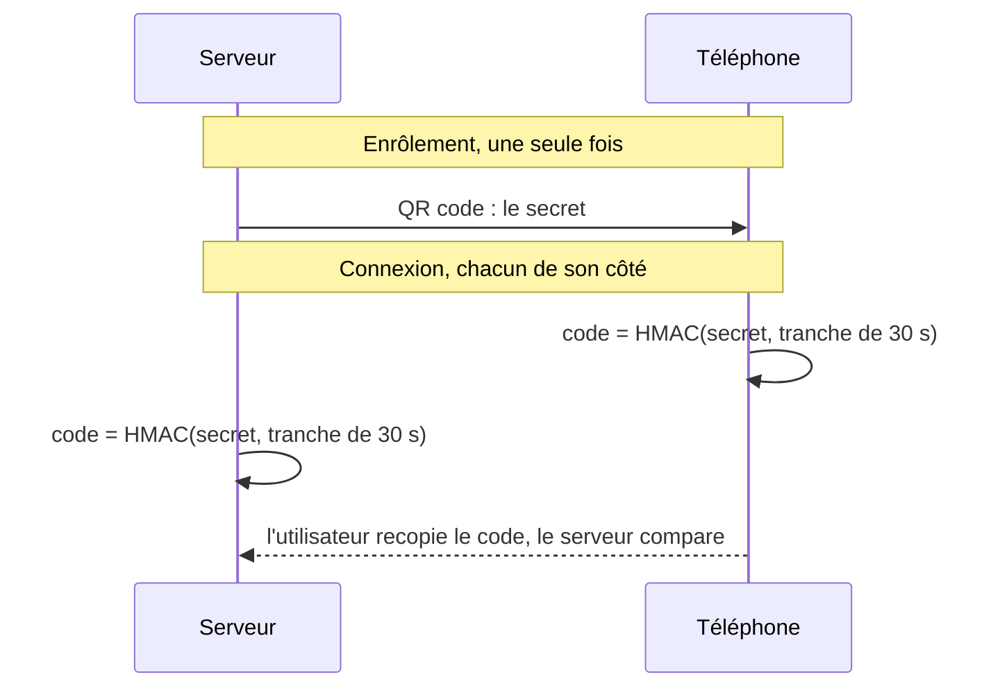
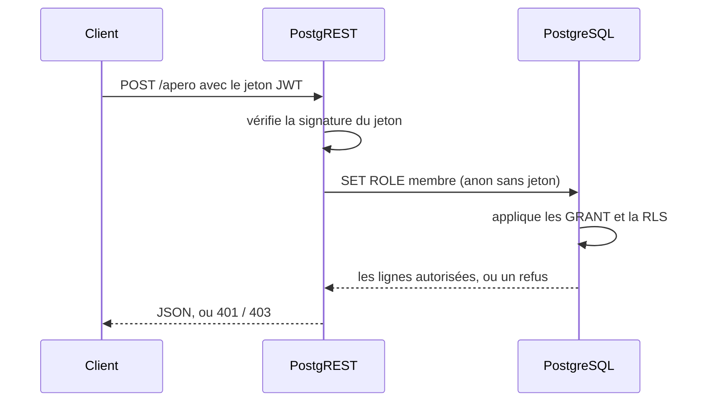

# Apero Tech #1 — Ce que l'IA génère sans vous le dire : déroulé détaillé

Nov 2, 2026 · @Loic

## Vue d'ensemble

Une heure, deux sujets reliés par un fil rouge : comment on prouve qui on est (OTP), puis comment on expose des données en toute sécurité (PostgREST). Chaque partie a deux étages : une idée simple que tout le monde peut répéter à la machine à café, puis le détail technique pour les devs.

**L'angle de la soirée** : ces deux briques, une IA les génère aujourd'hui en cinq minutes. On regarde ce qu'elle ne dit pas : le code à 6 chiffres se fait relayer par le phishing en temps réel, et une API générée sans droits laisse la base ouverte. C'est ce qui rend les deux sujets actuels pour les stagiaires et les alternants.

Les slides et le code des démos sont dans le dépôt [github.com/lgangloff/apero-tech-1](https://github.com/lgangloff/apero-tech-1), avec un README pour tout lancer. Les démos sont en Java pour l'OTP, en SQL et en requêtes HTTP pour PostgREST.

**Ce que chaque public doit retenir**

- Recruteurs et managers : le code 2FA n'est pas envoyé par le serveur, il est calculé ; et « une API sans backend » existe, mais elle fait débat.
- Devs : comment implémenter TOTP proprement, et dans quels cas PostgREST est un bon choix (ou un piège).

**Minutage**

| Début | Durée | Séquence | Format |
| --- | --- | --- | --- |
| 0:00 | 5 min | Ouverture et accroche | Question à la salle |
| 0:05 | 20 min | Partie 1 : OTP | Explication + démo live |
| 0:25 | 5 min | Questions OTP et transition | Échange |
| 0:30 | 20 min | Partie 2 : PostgREST | Démo live + débat |
| 0:50 | 10 min | Clôture et questions | Échange, teaser |

La marge de 10 min en fin de session absorbe les démos qui débordent et les deux passages sur l'IA (2 min chacun) ; si tout va bien, elle devient du temps d'échange autour de l'apéro.

## Ouverture (0:00 – 0:05)

L'accroche est une question à main levée qui révèle une idée reçue, résolue pendant la partie 1.

1. **Le concept (30 s).** « Un Apero Tech, c'est un sujet technique, un verre, et le droit de poser des questions bêtes. Un par mois, sujets ouverts à tous. »
2. **Question 1 à la salle.** « Levez la main si vous avez tapé un code à 6 chiffres cette semaine. » Presque toute la salle lève la main.
3. **Question 2, le piège.** « Gardez la main levée si vous pensez que le code de votre appli d'authentification vous est envoyé par le serveur. » La majorité reste levée. « C'est faux, et dans 15 minutes vous saurez pourquoi. »
4. **Le fil rouge.** « Aujourd'hui, deux questions : comment prouver qui on est, puis comment ouvrir l'accès à des données sans écrire de backend, et sans ouvrir la porte à tout le monde. Deux briques qu'une IA vous génère aujourd'hui en cinq minutes : ce soir, on regarde ce qu'elle ne vous dit pas. »

Garder une slide unique avec les deux questions : elle sert aussi de sommaire.

## Partie 1 : OTP (0:05 – 0:25)

Le message central : le téléphone et le serveur ne se parlent jamais, ils calculent chacun le même code à partir d'un secret partagé une seule fois et de l'heure.

### 0:05 – 0:08 · Le problème

- Un mot de passe seul ne suffit plus : fuites de bases, réutilisation d'un site à l'autre.
- Trois façons de prouver qui on est : ce que je **sais** (mot de passe), ce que je **possède** (téléphone), ce que je **suis** (empreinte).
- La double authentification combine deux de ces familles. L'OTP sert à prouver « ce que je possède ».

### 0:08 – 0:13 · Le mécanisme

**Étage grand public : deux montres et un secret.** À l'inscription, le serveur et le téléphone reçoivent le même secret, via le QR code. Ensuite, toutes les 30 secondes, chacun calcule un code à partir de ce secret et de l'heure qu'il est. Même secret + même heure = même code. Personne n'a rien envoyé.



Le QR code est le seul échange entre les deux : ensuite, le même calcul des deux côtés donne le même code.

**Étage dev : les deux RFC.**

- TOTP (RFC 6238) : code = HMAC-SHA1(secret, tranche), réduit à 6 chiffres par « troncature dynamique ». La tranche est le nombre de tranches de 30 s écoulées depuis 1970.
- Le QR code ne contient qu'une URI : `otpauth://totp/MaBoite:alice?secret=JBSWY3DPEHPK3PXP&issuer=MaBoite`.

```latex
\mathrm{TOTP} = \mathrm{Tronque}\left(\mathrm{HMAC\text{-}SHA1}\left(K,\ \left\lfloor \frac{t_{\mathrm{unix}}}{30} \right\rfloor\right)\right) \bmod 10^{6}
```

### 0:13 – 0:20 · Démo live

1. Lancer `java Totp.java enroll | clip` (sur macOS : `| pbcopy`) : le programme génère un secret et copie son URI. La coller dans le champ de la slide de démo, qui affiche le QR code en grand.
2. Faire scanner le QR par un volontaire non-dev, avec son appli d'authentification (Google Authenticator, Authy…).
3. **Lui faire passer son téléphone en mode avion devant tout le monde.** C'est le moment qui marque.
4. Lancer `java Totp.java` : le même code s'affiche au même instant dans le terminal et sur le téléphone, et change en même temps. Le volontaire lit son code à voix haute.
5. Afficher le contenu brut du QR (l'URI). « Voilà tout ce qui a été échangé, une seule fois. Si quelqu'un photographie ce QR, il a votre double authentification. »

Tout le calcul tient dans une fonction Java, sans dépendance : `javax.crypto.Mac` est dans le JDK. `otp/Totp.java` est un fichier source compact de Java 25, sans classe ni import, lancé directement avec `java Totp.java` : un clin d'œil à un futur Apero Tech sur Java.

```java
String totp(byte[] key, long counter) throws Exception {
    Mac mac = Mac.getInstance("HmacSHA1");
    mac.init(new SecretKeySpec(key, "HmacSHA1"));
    byte[] h = mac.doFinal(ByteBuffer.allocate(8).putLong(counter).array());

    int offset = h[h.length - 1] & 0x0F;                            // troncature dynamique
    int code = ByteBuffer.wrap(h, offset, 4).getInt() & 0x7FFFFFFF; // 31 bits, sans le signe
    return "%06d".formatted(code % 1_000_000);
}

// Appelée chaque seconde avec la tranche de 30 s en cours
totp(key, Instant.now().getEpochSecond() / 30);
```

**Si le scan échoue** ou si l'appli bloque la recopie d'écran : le code affiché par la slide de démo et celui du terminal suffisent à montrer que le calcul est le même des deux côtés.

### 0:20 – 0:25 · Pièges et limites

**Pour les devs : ce qu'on rate souvent en l'implémentant.**

| Piège | Parade |
| --- | --- |
| Horloges décalées | Accepter la tranche précédente et la suivante, pas plus |
| Code rejoué | Mémoriser la dernière tranche utilisée et refuser un code déjà consommé |
| Force brute (1 million de codes possibles) | Limiter les tentatives, puis bloquer temporairement |
| Secret volé en base | Le chiffrer, pas le hacher : le serveur doit pouvoir le relire |
| Téléphone perdu | Fournir des codes de secours à l'activation |

**Le phishing qui relaie le code** (2 min, slide « Le phishing qui relaie votre code », juste avant l'échelle SMS / appli / passkey). Le faux site n'est plus artisanal, il est industriel.

- **Le relais en temps réel.** Des kits vendus par abonnement se placent entre la victime et le vrai site. Ils relaient le mot de passe et le code pendant qu'il est encore valide, puis gardent la session. Le plus connu, Tycoon 2FA, représentait à son pic environ 62 % des tentatives de phishing bloquées par Microsoft ; Europol et Microsoft l'ont démantelé en mars 2026, et 330 domaines ont été mis hors ligne ([Help Net Security](https://www.helpnetsecurity.com/2026/03/05/tycoon-2fa-phishing-platform-takedown-europol/)).
- **La conséquence.** Le TOTP, le SMS et la notification push se font relayer ; seules les méthodes FIDO2, dont les passkeys, résistent ([SRA](https://sra.io/?p=257984)). La raison : une passkey est liée au nom de domaine du vrai site, et le faux site n'a rien à relayer.
- **La phrase pour la salle** : « L'OTP arrête les mots de passe volés en masse, pas un faux site qui relaie votre code en direct. »

**Pour tout le monde : les limites.**

- Le SMS, ce n'est pas pareil : là, le code est vraiment envoyé, donc interceptable (vol de carte SIM, « SIM swapping »).
- Un faux site peut demander votre code et le rejouer sur le vrai dans les 30 secondes. Les passkeys résistent à ça car elles sont liées au nom de domaine : un bon sujet pour un prochain Apero Tech.

**À retenir** : le code est calculé, pas envoyé · le QR code est la vraie clé · l'appli bat le SMS, la passkey bat l'appli.

## Questions et transition (0:25 – 0:30)

Cinq minutes de questions sur l'OTP, puis une phrase-pont qui annonce la partie 2.

- **Si la salle est silencieuse**, relancer avec : « Qui a déjà perdu son téléphone avec la 2FA dessus ? Comment vous avez fait ? » Ça amène naturellement les codes de secours.
- **La phrase-pont** : « On sait maintenant prouver qui on est. Mais une fois connecté, qu'a-t-on le droit de voir ? Et faut-il vraiment écrire trois couches de backend pour répondre à ça ? »

## Partie 2 : PostgREST (0:30 – 0:50)

Le message central : PostgREST lit la structure de la base et en déduit une API REST complète, et c'est Postgres lui-même qui décide qui a le droit de faire quoi.

Précision à donner dès le début : ce n'est pas une extension de Postgres, mais un petit serveur autonome placé devant la base. C'est la brique sur laquelle repose Supabase.

**Pourquoi ça parle aux stagiaires et aux alternants** : Supabase fournit son API REST avec PostgREST ([doc Supabase](https://supabase.com/docs/guides/api)), et des outils comme Lovable branchent Supabase sous les applis qu'ils génèrent. Ce qu'on démonte ce soir, c'est le backend de leurs applis générées par IA.

### 0:30 – 0:33 · Le problème

- Question à la salle : « Combien de fichiers pour exposer une table `produits` en lecture et écriture dans un backend Spring classique ? » Contrôleur, service, repository, DTO, mapping, tests… pour chaque table.
- **Étage grand public** : PostgREST est un traducteur automatique entre le web et la base. Il lit les tables et sait répondre aux questions posées dans une URL.
- **Étage dev** : chaque table ou vue d'un schéma exposé devient une ressource REST ; chaque fonction SQL devient un appel `/rpc/…`.

### 0:33 – 0:40 · Démo live (thème : l'apéro)

1. **Démarrer** avec `docker compose up -d`, et montrer les 4 lignes de configuration de PostgREST : URL de la base, schéma exposé, rôle anonyme, secret JWT. Les rôles sont déjà créés par `init.sql` au démarrage.
2. **Créer la table** en direct avec `docker compose exec db psql -U postgres -f /demo/apero.sql`, en montrant le fichier :

```sql
create table api.apero (
  id    int generated always as identity primary key,
  nom   text not null,
  type  text check (type in ('boisson', 'grignotage')),
  degre numeric
);

insert into api.apero (nom, type, degre) values
  ('Pastis', 'boisson', 45), ('Chips', 'grignotage', null), ('Bière', 'boisson', 5);

grant select         on api.apero to anon;     -- tout le monde peut lire
grant select, insert on api.apero to membre;   -- seuls les membres ajoutent

notify pgrst, 'reload schema';                 -- PostgREST découvre la table
```

3. **Lire**, sans avoir écrit une ligne de backend : ouvrir `apero.http` dans VS Code et lancer les requêtes 1 à 3 avec « Send Request ».

```http
### 1. Lire toute la table
GET {{host}}/apero

### 2. Filtrer : les boissons à plus de 10 degrés
GET {{host}}/apero
    ?type=eq.boisson
    &degre=gt.10

### 3. Choisir les colonnes et trier
GET {{host}}/apero
    ?select=nom,degre
    &order=degre.desc.nullslast
```

4. **Écrire en anonyme** avec la requête 4, et se faire refuser (401) :

```http
### 4. Ajouter des olives sans jeton
POST {{host}}/apero
Content-Type: application/json

{ "nom": "Olives", "type": "grignotage" }
```

Le refus est voulu : « Bonne nouvelle, tout le monde ne peut pas ajouter des olives. Voyons pourquoi. »

Le bonus est sauté par défaut, pour laisser la place à la Row Level Security. On le garde pour les questions de fin, s'il reste du temps : lancer `bonus.sql` (une table `participant` avec une clé étrangère vers `apero`), puis la requête 11 : la jointure « qui apporte quoi » sort toute seule. La requête 12 renvoie la description OpenAPI de toute l'API.

### 0:40 – 0:48 · La sécurité, la Row Level Security, et le lien avec l'OTP



PostgREST ne décide d’aucun droit lui-même : il transmet le rôle du jeton, et Postgres applique ses `GRANT` et sa RLS.

- PostgREST se connecte avec un rôle `authenticator` qui ne peut rien faire seul. À chaque requête, il endosse le rôle indiqué dans le JWT, ou `anon` sans jeton.
- Les droits sont des `GRANT` SQL classiques. Pour filtrer ligne par ligne (« chacun ne voit que ses commandes »), on utilise la Row Level Security de Postgres.
- Rejouer le POST (requête 5) avec le jeton du rôle `membre` : cette fois, les olives arrivent (201). Avec ce même jeton, la requête 6 ne peut pas supprimer le pastis (403).
- **Le lien avec la partie 1** : l'OTP vérifie qui vous êtes au moment du login ; le JWT transporte ensuite cette identité jusqu'à la base.

```sql
-- init.sql, exécuté au démarrage du conteneur
create role anon nologin;
create role membre nologin;
create role authenticator noinherit login password 'mdp_demo';
grant anon, membre to authenticator;
grant usage on schema api to anon, membre;

-- apero.sql, en direct
grant select         on api.apero to anon;
grant select, insert on api.apero to membre;
```

Le jeton est un JWT signé en HMAC-SHA256 : la même famille de calcul que l'OTP, ce qui fait le pont avec la partie 1. Il est déjà dans `apero.http`, et `token.sh` le fabrique en trois lignes avec openssl.

**Les droits, ligne par ligne : la Row Level Security** (4 min, slide « Les droits, ligne par ligne », juste avant l'incident Lovable). `GRANT` dit qui touche la table, la RLS dit quelles lignes. Pour tout le monde : un classeur partagé, où chacun lit toutes les fiches mais ne peut raturer que les siennes.

1. Lancer `docker compose exec db psql -U postgres -f /demo/rls.sql` : une colonne `apporte_par` remplie depuis le jeton, la RLS activée, deux politiques. Tout ce qui existe déjà appartient à Bob.
2. Requête 7 : Alice ajoute du saucisson (201), signé « alice » sans qu'elle l'écrive.
3. Requête 8 : Alice supprime le pastis de Bob. Réponse 200, liste vide : pas d'erreur, la ligne n'existe tout simplement pas pour elle. C'est le moment fort.
4. Requête 9 : Alice retire son saucisson, et cette fois la ligne part.
5. Requête 10 : Alice écrit au nom de Bob, 403, refusé par `WITH CHECK`.

```sql
create policy mes_apports on api.apero
  for all to membre
  using      (apporte_par = public.jwt_sub())   -- les lignes qu'il peut modifier ou supprimer
  with check (apporte_par = public.jwt_sub());  -- les lignes qu'il a le droit d'écrire
```

- `jwt_sub()` lit le claim `sub` du jeton dans `request.jwt.claims`, que PostgREST remplit à chaque requête ([doc PostgREST](https://docs.postgrest.org/en/latest/references/auth.html)). Chez Supabase, la même fonction s'appelle `auth.uid()`.
- Pourquoi Alice voit quand même tout : la politique `lire_tout` de `rls.sql` laisse tout le monde lire. Les politiques s'additionnent : `mes_apports` ne restreint que l'écriture et la suppression.
- Les pièges, si on demande : RLS activée sans politique, plus personne ne voit rien ; le propriétaire de la table et les superutilisateurs passent outre ; une vue s'exécute avec les droits de son propriétaire, sauf `security_invoker` depuis Postgres 15 ([doc PostgREST](https://docs.postgrest.org/en/latest/schema_structure.html)) ; un `using (true)` partout, c'est une RLS décorative.
- Le temps : ces 4 minutes viennent du bonus (jointure et OpenAPI, sauté) et du débat, raccourci d'une minute. D'où ce créneau de 8 minutes au lieu de 4.

**Quand l'IA oublie les droits : l'incident Lovable** (2 min, slide « Quand l'IA oublie les droits », juste après « Les droits, ligne par ligne »). Le 21 mars 2025, Matt Palmer (Replit) passe au scanner les 1 645 applis de Lovable Launched, la vitrine de Lovable. 170 d'entre elles, soit 10,3 %, exposent 303 endpoints Supabase lisibles sans être connecté : noms, téléphones, paiements, abonnements, clés d'API ([déclaration de Matt Palmer](https://welcome-b52.pages.dev/posts/2025/05/statement-on-CVE-2025-48757)). Le scan ne faisait que lire, et seulement depuis les pages d'accueil : c'est un minimum. Sur une des applis, Linkable, il a aussi pu écrire, en insérant une ligne marquée `payment_status: paid` sans passer par Stripe. La faille, CVE-2025-48757, est publiée le 29 mai 2025.

- **La cause** : la clé `anon` est publique par conception, ce n'était pas elle le problème. Les politiques RLS manquaient ou étaient fausses : exactement les règles que la démo vient de poser.
- **La suite** : Lovable a ajouté un scanner de sécurité, mais il vérifie seulement qu'une politique existe, pas qu'elle est juste. C'est le piège du `using (true)`.
- **Le geste** : rejouer la requête 8 (Alice ne peut pas supprimer le pastis de Bob) et dire « voilà la politique qui manquait à 170 applis ».
- **La phrase pour la salle** : « L'IA vous génère l'API en cinq minutes. Les droits, c'est encore vous. »

### 0:48 – 0:50 · Le débat : faut-il mettre la logique dans la base ?

|  | Pour | Contre |
| --- | --- | --- |
| Code | Zéro code CRUD à écrire et maintenir | Logique métier en SQL, moins familière pour l'équipe |
| Sécurité | Les droits vivent au même endroit que les données | Une erreur de `GRANT` expose directement la table |
| Évolution | Prototype en une heure | Renommer une colonne casse l'API (parade : n'exposer que des vues) |
| Tests | SQL testable avec pgTAP | Outillage moins courant que JUnit |

Puis la slide « Quand le choisir, quand l'éviter ».

| Bon terrain | Mauvais terrain |
| --- | --- |
| Back-office et outils internes : du CRUD avec des droits fins | Règles métier riches, qui changent souvent |
| API de lecture sur des données qui existent déjà | Orchestration de plusieurs services ou d'appels externes |
| Prototype ou MVP : le schéma d'abord, le front ensuite | Équipe peu à l'aise avec SQL et les droits Postgres |

Le bon test : vos règles tiennent-elles en contraintes et droits SQL ? Question à la salle, managers compris : « Quel projet que vous connaissez aurait coché la colonne de gauche ? » Noter les idées qui sortent : elles peuvent devenir des sujets.

**À retenir** : une API sans backend, c'est possible · la sécurité se règle dans la base, avec les rôles Postgres puis la Row Level Security · idéal pour démarrer, à challenger pour du métier complexe.

## Clôture (0:50 – 1:00)

On referme la boucle ouverte à 0:00, puis on lance la suite de la série.

1. **Retour à la question d'ouverture.** « Qui pense encore que le code est envoyé par le serveur ? » Plus personne : la salle vient de valider qu'elle a compris.
2. **Les deux phrases à retenir**, une par sujet, sur une seule slide.
3. **Vote pour le sujet du #2**, à main levée : « Software factory et IA », « Java 25 en avant / après » ou « Les passkeys ». La salle choisit la suite, c'est la meilleure raison de revenir. En option : annoncer que les slides et le code de la soirée ont été préparés avec une IA, et qu'on montrera comment si ce sujet gagne.
4. **Appel à sujets** : « Vous avez un sujet ? Venez le présenter, même en 15 minutes. » Prévoir un lien ou un canal pour les propositions.
5. **Questions libres** jusqu'à la fin, verre à la main.

## Préparation

Tout est dans le dépôt [github.com/lgangloff/apero-tech-1](https://github.com/lgangloff/apero-tech-1) : les slides, les deux démos et un README pour tout lancer. Les démos tournent en local, sans réseau, à condition de télécharger les images Docker la veille.

### Démo OTP

- Java 25 ou plus, rien d'autre : c'est la slide de démo qui affiche le QR code, sous Windows comme ailleurs.
- `java Totp.java enroll | clip` (sur macOS : `| pbcopy`) crée `demo-secret.txt` et copie l'URI à coller dans la slide ; `java Totp.java` affiche ensuite le code chaque seconde.
- Le calcul est vérifié avec les vecteurs de test de la RFC 6238, et la slide de démo donne le même code que `Totp.java` pour un même secret.
- **Attention** : beaucoup d'applis d'authentification bloquent la capture et la recopie d'écran (écran noir). D'où le volontaire qui lit son code à voix haute.

### Démo PostgREST

Les fichiers sont dans `postgrest/`. Les rôles et le schéma sont créés au premier démarrage par `init.sql` ; seule la table est créée en direct.

| Fichier | Rôle |
| --- | --- |
| `docker-compose.yml` | Postgres 17 et PostgREST 16.6 |
| `init.sql` | Schéma `api`, rôles `anon`, `membre` et `authenticator` |
| `apero.sql` | La table créée en direct, et ses droits |
| `rls.sql` | La Row Level Security : chacun ne modifie que ses propres apports |
| `bonus.sql` | La table `participant`, reliée par une clé étrangère |
| `apero.http` | Les 12 requêtes de la démo, pour l'extension REST Client |
| `token.sh` | Fabrique le JWT du rôle `membre` avec openssl, avec ou sans claim sub |

- VS Code avec l'extension REST Client (humao.rest-client) : un lien « Send Request » apparaît au-dessus de chaque requête de `apero.http`.
- `apero.sql` se termine par `notify pgrst, 'reload schema';` : sans ce signal, PostgREST ne voit pas la nouvelle table.
- Pour rejouer la démo depuis zéro : `docker compose down -v`, car `init.sql` ne s'exécute qu'au premier démarrage.
- Démo testée de bout en bout le 23 novembre 2026, sur une base neuve, avec PostgREST 16.6 et Postgres 17.12 : `apero.sql`, `rls.sql` puis `bonus.sql`, et les 12 requêtes donnent les réponses attendues. Les jetons de `apero.http` sont identiques à ceux de `token.sh`. Reste à la rejouer une fois en répétition, sur la machine de la soirée.
- Si l'API ne trouve pas la base (`could not translate host name "db"` dans les logs) : `docker compose up -d --force-recreate`. Ça arrive quand Docker Desktop a recréé son réseau.

### Checklist

- [ ] Dépôt cloné, images Docker téléchargées la veille
- [ ] Java 25 installé, et l'URI collée une fois dans la slide de démo pendant la répétition
- [ ] Démo OTP testée avec une vraie appli d'authentification
- [ ] Volontaire repéré pour scanner le QR
- [ ] Extension REST Client installée, `apero.http` joué de bout en bout
- [ ] Slides testées sur le vidéoprojecteur : plein écran (F), notes (N)
- [ ] Terminal et VS Code en grande police (20 pt minimum), thème clair
- [ ] Plan B : capture vidéo des deux démos, au cas où
- [ ] Apéro commandé (c'est dans le nom)

## Questions probables

Les questions qui reviennent le plus sur ces deux sujets, avec une réponse courte à donner sans hésiter.

| Sujet | Question | Réponse courte |
| --- | --- | --- |
| OTP | Pourquoi 30 secondes ? | Assez long pour taper le code, assez court pour limiter sa réutilisation ; c'est la valeur recommandée par la RFC. |
| OTP | Et si mon téléphone n'est pas à l'heure ? | Il se synchronise tout seul, et le serveur tolère une tranche avant ou après. |
| OTP | Google Authenticator et Authy, c'est pareil ? | Même algorithme standard, d'où l'interopérabilité ; la différence, c'est la sauvegarde du secret dans le cloud. |
| OTP | SHA-1 n'est pas cassé ? | Les attaques connues sur SHA-1 ne s'appliquent pas à HMAC ; l'usage reste considéré sûr. |
| OTP | Et les passkeys ? | Une clé privée qui ne quitte pas l'appareil et qui est liée au site : elle résiste au phishing. Sujet d'une prochaine session. |
| OTP | Si le code se fait relayer, à quoi bon activer l'OTP ? | Il bloque encore les mots de passe volés en masse. Contre un faux site qui relaie en direct, il faut une passkey. |
| PostgREST | Et la validation métier ? | Contraintes SQL (`check`, `not null`, clés étrangères), triggers, ou fonctions exposées via `/rpc`. |
| PostgREST | On peut le brancher sur notre SSO ? | Oui : il vérifie un JWT signé, il suffit que le fournisseur d'identité y mette le rôle. |
| PostgREST | Comment versionner l'API ? | Un schéma de vues par version (`api_v1`, `api_v2`), choisi par un en-tête HTTP. |
| PostgREST | Qui l'utilise vraiment ? | Supabase est construit dessus. |
| PostgREST | Une IA peut écrire mes politiques RLS ? | Oui, mais il faut les relire et les tester avec plusieurs rôles : une politique qui existe n'est pas forcément juste. |
| Recrutement | Quel profil pour travailler avec ça ? | Du SQL solide et une bonne maîtrise des droits Postgres, plus qu'un framework particulier. |

## Sources

Pour les passages sur l'IA, vérifiées le 24 novembre 2026.

- [Matt Palmer, déclaration sur la CVE-2025-48757](https://welcome-b52.pages.dev/posts/2025/05/statement-on-CVE-2025-48757) : scan du 21 mars 2025, 170 applis Lovable sur 1 645 (10,3 %), 303 endpoints lisibles sans connexion ; écriture démontrée sur Linkable
- [Documentation Supabase, Data REST API](https://supabase.com/docs/guides/api) : l'API REST de Supabase repose sur PostgREST
- [Help Net Security, démantèlement de Tycoon 2FA](https://www.helpnetsecurity.com/2026/03/05/tycoon-2fa-phishing-platform-takedown-europol/) : environ 62 % du phishing bloqué par Microsoft à son pic, 330 domaines mis hors ligne
- [SRA, se défendre contre le phishing AiTM](https://sra.io/?p=257984) : TOTP, SMS et push relayés ; seules les méthodes FIDO2 résistent
